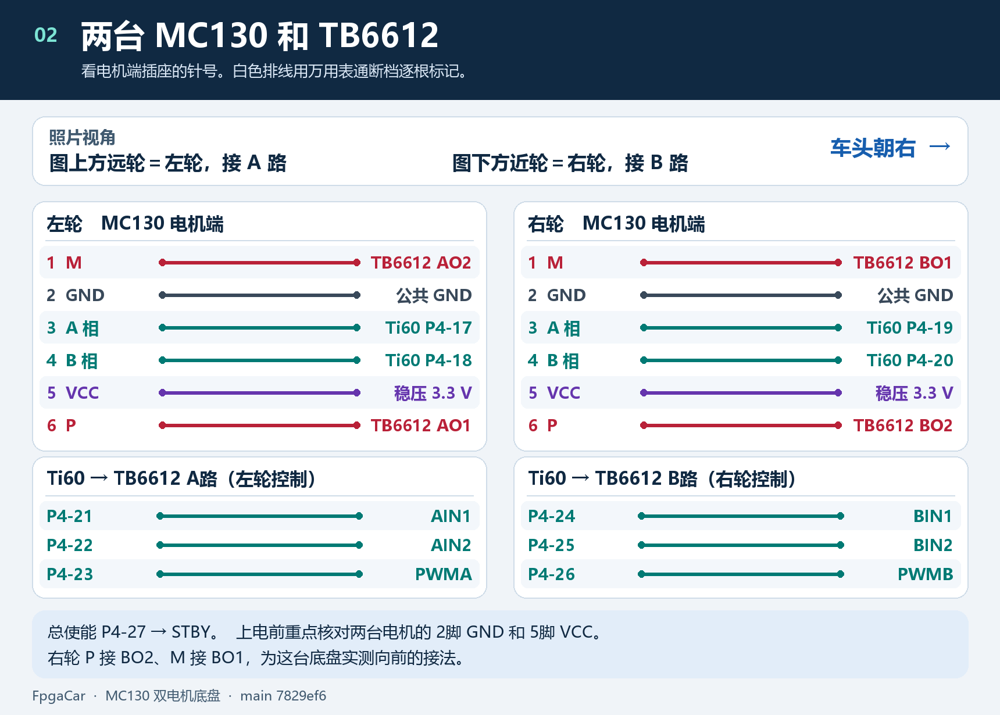

# MC130 双电机点动台架

独立工程复用 Ti60 主板引脚与编码器译码。接线采用 2026-11-22 新底盘架空实测后的极性。



| 位置 | MC130 电机端 1 脚 M | 电机端 6 脚 P | 编码器 A、B |
| --- | --- | --- | --- |
| 左轮，TB6612 A 路 | AO2 | AO1 | P4-17、P4-18 |
| 右轮，TB6612 B 路 | **BO1** | **BO2** | P4-19、P4-20 |

TB6612 的 VM 取稳压 6 V，两台编码器 5 脚取稳压 3.3 V，各模块共地。右轮动力线按上表连接，编码器计数方向在台架软件中反相。

## 生成和使用

从仓库根目录生成，然后在 Efinity 编译输出目录中的 `Mc130WheelBench.xml`。

```powershell
python bench/mc130-wheel/make_project.py .scratch/mc130-wheel-bench
```

架空车轮，确认接线后通过 JTAG 临时加载 `outflow/Mc130WheelBench.bit`。Windows 上 FT232H 绑定官方驱动时，按 [HiFTDI 说明](../../tools/README.md#6-windows-上没有-libusbk-时怎么烧hiftdi-后端)设置环境，用 `hiftdi_runner.py -m jtag` 加载该位流。断电重上电后由板载 Flash 启动。

- 松开两个键进入待机。**K1 点动左轮，K2 点动右轮**。PWM 为 25%，松手立即撤掉驱动，单次最长 0.5 秒。双键同时按下会锁止，重新松开两个键后可再点动。
- LED0、LED1 分别表示左路、右路正在驱动。板载串口使用 115200 8N1，`L/R` 为有符号累计计数，`VL/VR` 为 50 ms 内净增量，`DL/DR` 为 PWM 控制值。
- 编码器输入需稳定 10 µs 才接受一次状态变化。左右轮前进统一为正计数。

## 验证

实车架空时，两个轮子分别朝车头转。左轮点动时测得 `ΔL=+1303、ΔR=0`。右轮方向修正版临时下载后，K2 点动测得 `ΔL=0、ΔR=+1372`。松手停稳后，两路速度与 PWM 读数均为零。

从仓库根目录运行仿真。这里使用 Icarus Verilog。

```bash
bench=bench/mc130-wheel
mkdir -p .scratch
iverilog -g2012 -s wheel_jog_tb -o .scratch/wheel_jog.vvp "$bench/wheel_jog_tb.v" "$bench/WheelJog.v"
vvp .scratch/wheel_jog.vvp
iverilog -g2012 -s encoder_input_filter_tb -o .scratch/enc_filter.vvp "$bench/encoder_input_filter_tb.v" "$bench/WheelJog.v" src/encoder_dec.v
vvp .scratch/enc_filter.vvp
```
